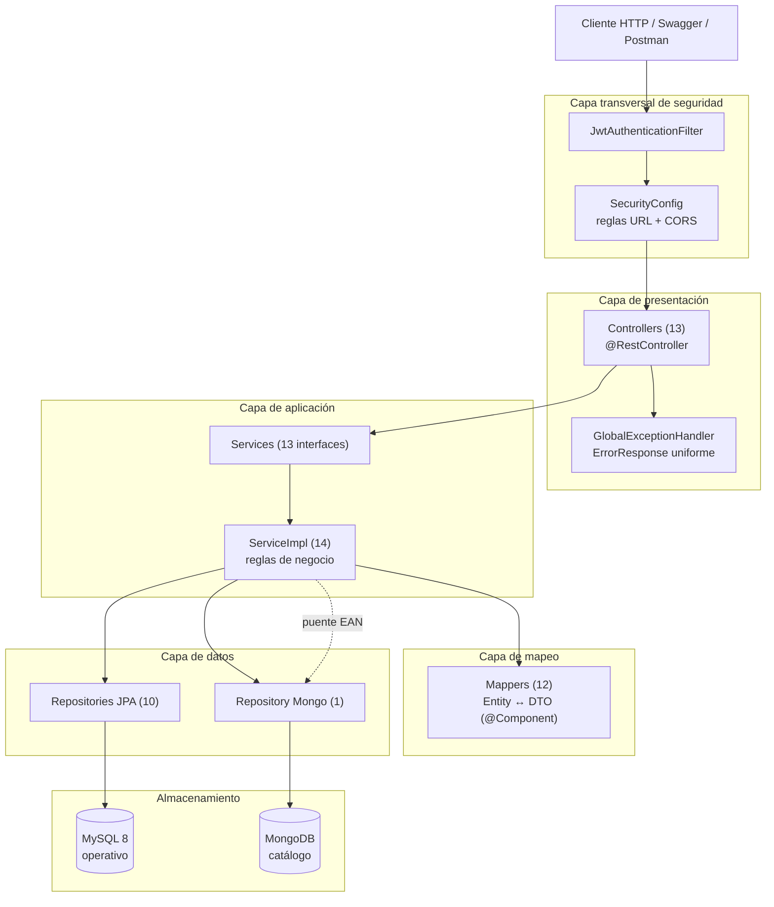
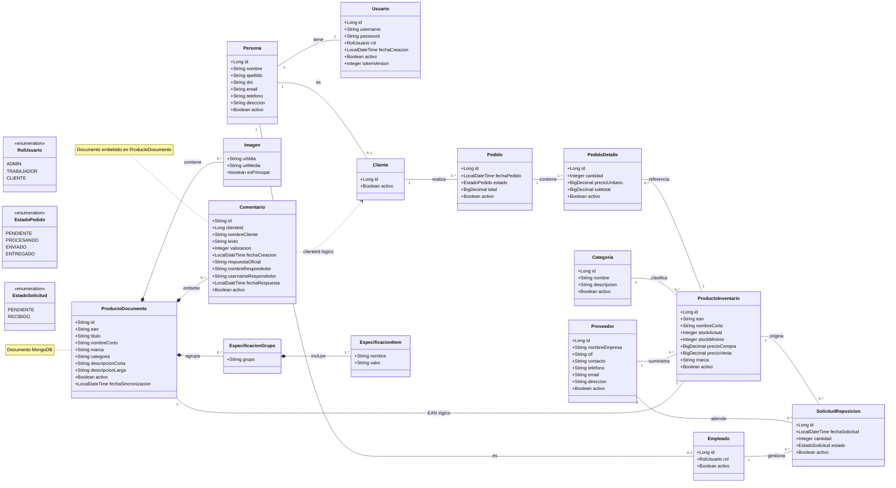
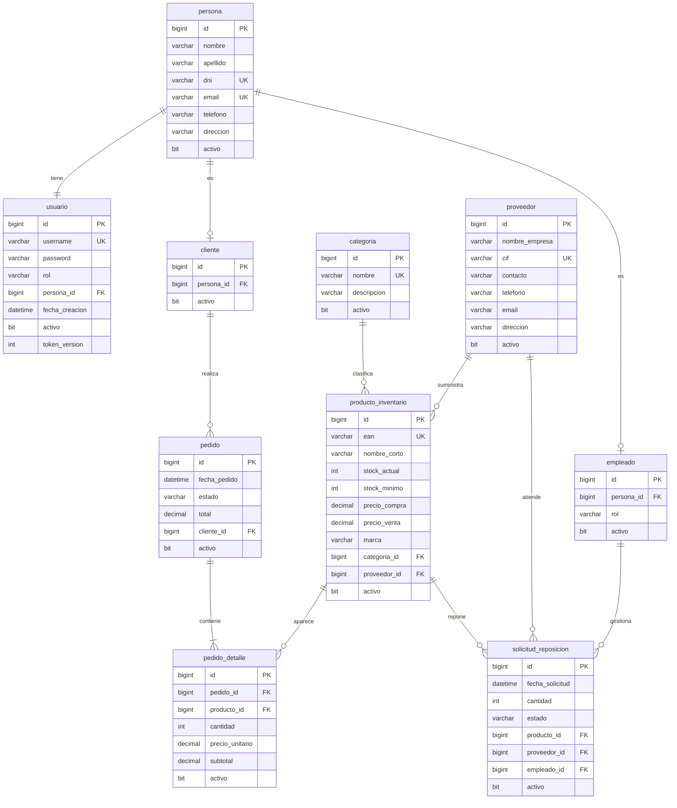
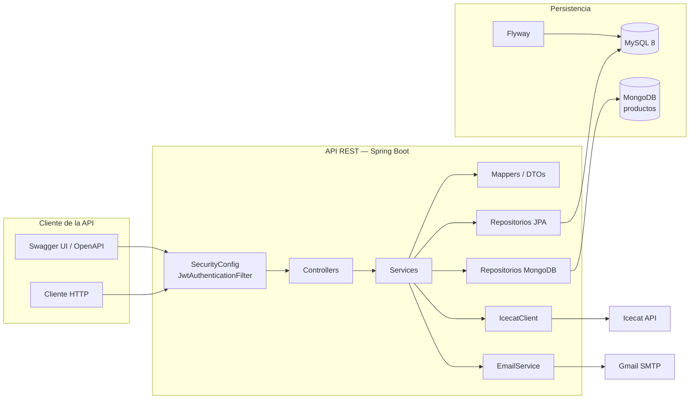

# TechNovaLD — API REST de E-commerce


---

## 📋 Índice

1. [Visión general](#-visión-general)
2. [Características principales](#-características-principales)
3. [Stack tecnológico](#-stack-tecnológico)
4. [Arquitectura en una vista](#-arquitectura-en-una-vista)
5. [Estructura de carpetas](#-estructura-de-carpetas)
6. [Puesta en marcha en local](#-puesta-en-marcha-en-local)
7. [Cómo ejecutar los tests](#-cómo-ejecutar-los-tests)
8. [Administrador inicial y secretos](#-administrador-inicial-y-secretos)
9. [Endpoints de la API](#-endpoints-de-la-api)
10. [Diagramas](#-diagramas)
11. [Documentación](#-documentación)
12. [Inventario de Funcionalidades (Para uso interno)](#-inventario-de-funcionalidades-para-uso-interno)

---

## 📄 Visión general

**TechNovaLD** es una API REST para la gestión de un e-commerce de informática y electrónica. Implementa el ciclo de catálogo público, registro de clientes, pedidos, gestión de inventario, reposición de stock, reseñas de producto y administración mediante endpoints.

El rasgo que define el diseño es la **persistencia políglota**:

- **MySQL 8** guarda todo lo **transaccional y operativo**: identidad (personas, usuarios, clientes, empleados), maestros (categorías, proveedores), inventario, pedidos y solicitudes de reposición. Es la fuente de verdad del stock y del dinero.
- **MongoDB** guarda el **catálogo enriquecido**: la ficha técnica de cada producto —título, nombre corto, descripciones, galería de imágenes en varias resoluciones, grupos de especificaciones— más los **comentarios embebidos** de los clientes.

Ambas orillas se unen por un único campo compartido: el **EAN** (código de barras). En MySQL es `producto_inventario.ean`; en MongoDB es `productos.ean`. Es el puente que permite resolver una ficha de catálogo a partir de una fila de inventario y a la inversa.

El control de acceso es **RBAC con JWT stateless** sobre tres roles: `ADMIN`, `TRABAJADOR` y `CLIENTE`. La separación de responsabilidades de datos es deliberada: aislar la alta carga de lectura del catálogo público (MongoDB) de las operaciones críticas de inventario y venta (MySQL).

---

## 🌟 Características principales

- **Arquitectura políglota** MySQL + MongoDB, con el EAN como identificador compartido.
- **Autenticación JWT** con revocación de tokens por versión (`usuario.token_version`): cambiar o resetear la contraseña invalida al instante todos los JWT anteriores aunque no hayan expirado.
- **RBAC de tres roles** aplicado en `SecurityConfig` por URL.
- **Registro público de clientes con auto-login**: el alta devuelve un JWT listo para usar.
- **Pedidos con congelación de precio**: el detalle guarda un *snapshot* del precio de venta en el momento de la compra, de modo que un cambio de tarifa posterior no altera pedidos históricos.
- **Descuento de stock atómico**: la comprobación y el decremento se resuelven en una sola sentencia SQL, lo que elimina la ventana de concurrencia que permitía sobrevender.
- **Recepción de reposición idempotente**: transición de estado condicional + incremento de stock atómico, de forma que dos peticiones simultáneas no dupliquen la entrada de mercancía.
- **Borrado lógico (soft delete) universal** mediante la columna `activo`, con baja en cascada gestionada por los servicios.
- **Baja voluntaria con motivo y notificación**: `DELETE /api/clientes/me` identifica al cliente por el JWT, desactiva cliente, persona y usuario sin borrar datos, y envía un correo o log con el motivo indicado.
- **Sincronización con Icecat** para descargar y mapear fichas técnicas reales a MongoDB, preservando los comentarios existentes al re-sincronizar.
- **Reseñas con respuesta oficial** del personal y bandeja de comentarios pendientes, resuelta con un *pipeline* de agregación de MongoDB.
- **Recuperación de contraseña por email**: simulación en consola en `dev` y Gmail SMTP en `prod`.
- **Documentación OpenAPI/Swagger** navegable y **migraciones Flyway** versionadas.
- **Paginación** en los listados de clientes y pedidos.

---

## 🛠️ Stack tecnológico

Versiones tomadas de `pom.xml`.

| Componente | Versión | Para qué |
|---|---|---|
| Java | **17** (`java.version`) | Lenguaje y bytecode objetivo |
| Spring Boot | **4.1.1** | Framework base (parent) |
| Spring Web | gestionada por Boot | API REST sobre Tomcat embebido |
| Spring Security | gestionada por Boot | Autenticación y autorización |
| Spring Data JPA / Hibernate | gestionada por Boot | Persistencia relacional (MySQL) |
| Spring Data MongoDB | gestionada por Boot | Persistencia documental (catálogo) |
| Spring Validation | gestionada por Boot | Validación de DTOs (`jakarta.validation`) |
| Spring Mail | gestionada por Boot | Envío del email de reseteo de contraseña |
| Spring Boot Actuator | gestionada por Boot | Monitorización y salud |
| MySQL | **8.0** | Base de datos operativa y transaccional |
| `mysql-connector-j` | gestionada por Boot | Driver JDBC |
| MongoDB | **6+** | Base de datos del catálogo |
| Flyway | starter de Boot + `flyway-mysql` | Migraciones versionadas del esquema |
| JJWT | **0.12.6** (`jjwt-api`, `jjwt-impl`, `jjwt-jackson`) | Generación y validación de JWT |
| springdoc-openapi | **3.1.0** | Swagger UI y especificación OpenAPI |
| Lombok | gestionada por Boot | Reducción de *boilerplate* |
| JUnit 5 + AssertJ + Mockito | vía `spring-boot-starter-test` | Pruebas |
| spring-security-test | vía Boot | Utilidades de test de seguridad |
| Maven Wrapper | incluido | Build reproducible sin Maven global |

**Notas de fidelidad al repositorio:**

- **No se usa MapStruct.** Los **12 mappers** son clases anotadas con `@Component` escritas a mano: `PersonaMapper`, `ClienteMapper`, `EmpleadoMapper`, `CategoriaMapper`, `ProveedorMapper`, `ProductoInventarioMapper`, `PedidoMapper`, `PedidoDetalleMapper`, `ComentarioMapper`, `ProductoCatalogoMapper`, `SolicitudReposicionMapper` e `IcecatMapper`.
- El *JAR* generado se llama **`app.jar`** porque el `pom.xml` fija `<finalName>app</finalName>`; así el comando de arranque no depende de la versión del proyecto.
- El esquema lo gestiona **exclusivamente Flyway**. Hibernate trabaja en `ddl-auto=validate`: solo comprueba que las entidades coinciden con el esquema, nunca lo modifica.
- Las migraciones actuales son **`V1__init_schema.sql`** (10 tablas) y **`V2__add_proveedor_cif.sql`** (CIF único y nullable en `proveedor`).

---

## 🏗️ Arquitectura en una vista

Arquitectura en capas estricta. Cada capa solo conoce a la de debajo:



### Regla de dependencia

```
controller  →  service (interfaz)  →  service.impl  →  mapper  →  repository  →  entity / document
```

- Los **controladores nunca tocan repositorios** ni entidades directamente: hablan con interfaces de servicio y devuelven DTOs.
- Las **entidades JPA nunca se serializan** como respuesta; todas las salidas son DTOs.
- El **puente entre almacenes vive en la capa de servicio**, no en los repositorios: los servicios son quienes cruzan MySQL y MongoDB por EAN.
- Las reglas RBAC viven en `SecurityConfig`; los controladores no repiten la comprobación de rol.

Los diagramas UML, Entidad-Relación y de flujo están en [Diagramas](#-diagramas).

---

## 📂 Estructura de carpetas

```text
TechNovaLD/
├── .mvn/wrapper/maven-wrapper.properties
├── src/
│   ├── main/
│   │   ├── java/com/technovald/
│   │   │   ├── TechNovaLdApplication.java      # Punto de entrada (@SpringBootApplication,
│   │   │   │                                   #  @EnableAsync)
│   │   │   ├── client/                         # IcecatClient: cliente HTTP del servicio externo
│   │   │   ├── config/                         # SecurityConfig, OpenApiConfig, RestTemplateConfig
│   │   │   ├── controller/                     # 13 controladores REST
│   │   │   ├── document/                       # 5 documentos MongoDB (catálogo)
│   │   │   ├── dto/
│   │   │   │   ├── request/                    # 17 DTOs de entrada
│   │   │   │   ├── response/                   # 20 DTOs de salida
│   │   │   │   └── icecat/                     # 11 DTOs que reflejan la respuesta de Icecat
│   │   │   ├── entity/                         # 10 entidades JPA (MySQL)
│   │   │   ├── enums/                          # RolUsuario, EstadoPedido, EstadoSolicitud
│   │   │   ├── exception/                      # Excepciones de dominio +
│   │   │   │                                   #  GlobalExceptionHandler
│   │   │   ├── mapper/                         # 12 mappers Entity ↔ DTO
│   │   │   ├── repository/
│   │   │   │   ├── mysql/                      # 10 repositorios JPA + ProductoMasVendidoProjection
│   │   │   │   └── mongo/                      # 1 repositorio MongoDB
│   │   │   ├── security/                       # JwtService, JwtAuthenticationFilter,
│   │   │   │                                   #  CustomUserDetailsService, CredentialGenerator
│   │   │   ├── seeder/                         # AdminBootstrapInitializer
│   │   │   └── service/                       # 13 interfaces (incluye EstadisticaService)
│   │   │       └── impl/                       # 14 implementaciones
│   │   └── resources/
│   │       ├── application.properties          # Configuración común
│   │       ├── application-dev.properties      # Perfil dev (local / IDE)
│   │       ├── application-prod.properties     # Perfil prod (SMTP y logs)
│   │       └── db/migration/
│   │           ├── V1__init_schema.sql         # 10 tablas (columnas, PK, unique, FK)
│   │           └── V2__add_proveedor_cif.sql   # CIF único y nullable en proveedor
│   └── test/
│       └── java/com/technovald/
│           ├── controller/
│           │   ├── AuthControllerTest.java
│           │   └── EstadisticaControllerTest.java
│           ├── exception/
│           │   └── GlobalExceptionHandlerTest.java
│           ├── integration/
│           │   └── TechNovaLdIntegrationTest.java
│           ├── security/
│           │   ├── JwtAuthenticationFilterTest.java
│           │   ├── JwtServiceTest.java
│           │   └── SecurityRoutesTest.java
│           ├── service/impl/
│           │   ├── AuthServiceImplTest.java
│           │   ├── CatalogoServiceImplTest.java
│           │   ├── CategoriaServiceImplTest.java
│           │   ├── ClienteServiceImplTest.java
│           │   ├── EmpleadoServiceImplTest.java
│           │   ├── EstadisticaServiceImplTest.java
│           │   ├── IcecatServiceImplTest.java
│           │   ├── InventarioServiceImplTest.java
│           │   ├── PedidoServiceImplTest.java
│           │   ├── ProveedorServiceImplTest.java
│           │   └── SolicitudReposicionServiceImplTest.java
│           └── TechNovaLdApplicationTests.java # Test de carga de contexto
├── .env.example
├── .gitattributes
├── .gitignore
├── mvnw
├── mvnw.cmd
├── pom.xml
└── README.md
```

El árbol muestra solo el backend y sus recursos de configuración; el fichero `.env` no se versiona.

**Cómputo de ficheros:** 13 controladores + 13 interfaces de servicio + 14 implementaciones + 12 mappers + 10 entidades + 5 documentos + 3 enums + 48 DTOs + 11 repositorios + 1 proyección + 4 excepciones + 4 clases de seguridad + 1 seeder + 3 clases de configuración + 1 cliente + 1 entrada = **144 ficheros Java**.

---

## 🚀 Puesta en marcha en local

Para ejecutar la API directamente desde el IDE o la terminal, con MySQL y MongoDB instalados en la máquina.

### Requisitos previos

| Requisito | Versión | Comprobación |
|---|---|---|
| JDK | **17** o superior (el bytecode objetivo es 17) | `java -version` |
| MySQL | **8.0** en adelante, escuchando en `localhost:3306` | `mysql --version` |
| MongoDB | Accesible en `localhost:27017` | `mongosh --eval "db.runCommand({ping:1})"` |
| Maven Wrapper | incluido en el repositorio | `.\mvnw.cmd -v` |

> El **Maven Wrapper** (`mvnw` / `mvnw.cmd`) viene incluido, así que **no necesitas instalar Maven**. Usa `./mvnw` en Linux/macOS y `.\mvnw.cmd` en Windows.

### 1. Clonar y crear el fichero de entorno

```bash
git clone <URL_DEL_REPOSITORIO>
cd TechNovaLD

# Linux / macOS
cp .env.example .env

# Windows (PowerShell)
Copy-Item .env.example .env
```

El `.env` está en `.gitignore` y **nunca debe subirse al repositorio**. Se carga en local de forma automática porque `application.properties` incluye:

```properties
spring.config.import=optional:file:.env[.properties]
```

### 2. Rellenar el `.env` (perfil dev)

Valores mínimos para arrancar en local. **No escribas secretos reales en ningún fichero versionado**: aquí van solo para tu máquina.

```properties
SPRING_PROFILES_ACTIVE=dev
PORT=8080

# MySQL local
MYSQL_HOST=localhost
MYSQL_PORT=3306
MYSQL_DATABASE=technovald
MYSQL_USER=root
MYSQL_PASSWORD=<TU_PASSWORD_LOCAL>

# MongoDB (la base va incluida en la URI)
MONGO_URI=mongodb://localhost:27017/technovald_catalogo

# Icecat (API externa de fichas de producto)
ICECAT_URL=https://live.icecat.biz/api/?UserName=...&Language=es&GTIN=
ICECAT_TOKEN=<TU_TOKEN_ICECAT>

# JWT
JWT_SECRET=<CADENA_BASE64_DE_AL_MENOS_256_BITS>
JWT_EXPIRATION=86400000

# Administrador inicial (solo se usa con la tabla usuario vacía)
BOOTSTRAP_ADMIN_USERNAME=admin.technovald
BOOTSTRAP_ADMIN_PASSWORD=<TU_PASSWORD_INICIAL>

# SMTP (solo se usa con el perfil prod)
GMAIL_USER=<TU_EMAIL>
GMAIL_APP_PASSWORD=<TU_APP_PASSWORD>
```

`JWT_SECRET` debe ser una cadena **codificada en Base64** de al menos 256 bits (32 bytes antes de codificar), porque JJWT lo exige para firmar con HS256. Puedes generar una con:

```bash
openssl rand -base64 32
```

En PowerShell:

```powershell
$rng = [System.Security.Cryptography.RandomNumberGenerator]::Create()
$bytes = New-Object byte[] 32
$rng.GetBytes($bytes)
[Convert]::ToBase64String($bytes)
```

### 3. Crear la base de datos

La URL JDBC incluye `createDatabaseIfNotExist=true`, así que **MySQL crea el esquema vacío por sí solo**. No hace falta ejecutar ningún SQL a mano: al arrancar, **Flyway** aplica las migraciones `V1` (tablas) y `V2` (CIF de proveedor) y las registra en `flyway_schema_history`.

> ⚠️ **La base de datos debe estar vacía en el primer arranque con Flyway.** Si el esquema lo creó antes Hibernate con `ddl-auto=update`, esas tablas no están en `flyway_schema_history` y Flyway abortará con `Found non-empty schema but no schema history table`. En ese caso, borra el esquema y vuelve a arrancar:
>
> ```bash
> mysql -u root -p -e "DROP DATABASE IF EXISTS technovald; CREATE DATABASE technovald;"
> ```

MongoDB no necesita creación manual: la base de `MONGO_URI` se crea en el primer documento y los índices se generan con `auto-index-creation`.

### 4. Arrancar la aplicación

```bash
# Linux / macOS
./mvnw spring-boot:run

# Windows
.\mvnw.cmd spring-boot:run
```

En el arranque verás, en este orden:

1. Flyway aplicando `V1` y `V2` (solo la primera vez).
2. El administrador inicial, si la tabla `usuario` está vacía.
3. El mensaje `Started TechNovaLdApplication`.

### 4.1. Cargar datos de demostración

El seed de demo es independiente del administrador inicial y **solo se ejecuta en `dev`**. En desarrollo está **activado por defecto**; los tests lo desactivan desde Surefire para no consultar Icecat.

```powershell
$env:SPRING_PROFILES_ACTIVE = "dev"
.\mvnw.cmd spring-boot:run
```

Se puede desactivar con:

```powershell
$env:APP_SEED_ENABLED = "false"
```

Carga:

- 20 clientes y 5 trabajadores, con correos `@yopmail.com`.
- Contraseña común: `Demo1234!`.
- 6 categorías y 10 proveedores.
- 18 productos validados contra Open Icecat; si un EAN no está disponible, se omite y se registra el motivo.
- 18 fichas de catálogo en MongoDB.
- 10 reseñas, 5 pedidos y 3 solicitudes de reposición.

El seeder es idempotente: si ya existen categorías o clientes, no duplica nada. Para desactivarlo, usa `APP_SEED_ENABLED=false`.

Los productos se validan **antes** de insertarse con `IcecatClient` y usan `IcecatMapper` para crear la ficha MongoDB. No se incluyen marcas que solo están en Full Icecat (Apple, HP, Lenovo, Intel, AMD, Western Digital o Corsair).

### 5. Comprobar que está viva

| Recurso | URL |
|---|---|
| Swagger UI (documentación interactiva) | <http://localhost:8080/swagger-ui.html> |
| Especificación OpenAPI (JSON) | <http://localhost:8080/v3/api-docs> |

### Perfiles

| Perfil | Activación | Puerto | Correo | Logs |
|---|---|---|---|---|
| `dev` | Por defecto (`spring.profiles.default=dev`) | `8080` | Se imprime en consola | SQL y `DEBUG` |
| `prod` | `SPRING_PROFILES_ACTIVE=prod` | `${PORT:8080}` | Gmail SMTP | `INFO` |

#### Cambiar entre `dev` y `prod`

El perfil **no se elige dentro de `application.properties`**: se indica al arrancar. La aplicación es la misma; el perfil activa configuración y beans distintos.

```powershell
# Desarrollo
$env:SPRING_PROFILES_ACTIVE = "dev"
.\mvnw.cmd spring-boot:run

# Producción
$env:SPRING_PROFILES_ACTIVE = "prod"
$env:GMAIL_USER = "cuenta@gmail.com"
$env:GMAIL_APP_PASSWORD = "app-password"
.\mvnw.cmd spring-boot:run
```

También se puede pasar como argumento:

```powershell
.\mvnw.cmd spring-boot:run "-Dspring-boot.run.arguments=--spring.profiles.active=prod"
```

En el IDE se configura en **Active profiles**; en Docker/despliegue, con la variable `SPRING_PROFILES_ACTIVE`.

#### Dónde se modifica cada cosa

| Qué quieres cambiar | Dónde |
|---|---|
| Perfil activo | `SPRING_PROFILES_ACTIVE` o `--spring.profiles.active` |
| Credenciales y datos de conexión | `.env` o variables de entorno del sistema |
| Puerto de desarrollo | `application-dev.properties` (`server.port=8080`) |
| Puerto de producción | Variable `PORT`; por defecto `8080` |
| Correo en desarrollo | `EmailServiceLogImpl`; no requiere SMTP |
| Correo en producción | `application-prod.properties` + `GMAIL_USER` y `GMAIL_APP_PASSWORD` |
| SQL y nivel de logs en desarrollo | `application-dev.properties` |
| Nivel de logs en producción | `application-prod.properties` |
| Datos de demostración | `DataInitializer`; activo en `dev` por defecto, se desactiva con `APP_SEED_ENABLED=false` |
| Administrador inicial | `BOOTSTRAP_ADMIN_USERNAME` y `BOOTSTRAP_ADMIN_PASSWORD` |
| MySQL/MongoDB/JWT/Icecat | `application.properties` + valores del `.env` |

#### La base de datos no cambia sola con el perfil

`application.properties` define la conexión con las variables del `.env`:

```properties
spring.datasource.url=jdbc:mysql://${MYSQL_HOST:localhost}:${MYSQL_PORT:3306}/${MYSQL_DATABASE}...
spring.mongodb.uri=${MONGO_URI}
```

Por tanto, `dev` y `prod` apuntan a la **misma** base si no cambias esas variables. Para usar bases distintas:

- Ten un `.env` local para desarrollo y variables de entorno de producción en el servidor/Docker.
- O define URLs específicas en `application-dev.properties` y `application-prod.properties`, usando variables de entorno para las credenciales.

No se deben escribir contraseñas directamente en los `.properties`: van en `.env` o en el gestor de secretos del despliegue.

#### Qué hace cada perfil

- **`dev`**: pensado para trabajar en local. Usa el puerto fijo `8080`, muestra SQL, activa `DEBUG`, imprime los correos en consola y carga los datos de demostración por defecto. Se puede desactivar con `APP_SEED_ENABLED=false`; los tests lo desactivan desde Surefire.
- **`prod`**: pensado para el servidor. Usa el puerto que indique `PORT`, reduce los logs a `INFO`, activa Gmail SMTP, respeta las cabeceras del proxy y **no** ejecuta el seeder de demostración.

`AdminBootstrapInitializer` no depende del perfil: crea el administrador inicial si la tabla `usuario` está vacía y existen las credenciales en el entorno.

### Problemas frecuentes

| Síntoma | Causa y solución |
|---|---|
| `Communications link failure` | MySQL no está corriendo o el puerto/password del `.env` no coinciden. |
| `Found non-empty schema ... but no schema history table` | El esquema lo creó Hibernate antes de Flyway. Bórralo y rearranca (ver paso 3). |
| `Unable to connect to MongoDB` | MongoDB no está levantado, o `MONGO_URI` apunta a otro sitio. |
| `WeakKeyException` de JJWT | El `JWT_SECRET` no está en Base64 o tiene menos de 256 bits. |
| `No hay producto en el inventario con EAN...` | El EAN de sincronización no existe en `producto_inventario`. |
| Error 503 al sincronizar con Icecat | Sin Internet, token inválido o cuota agotada; el resto de la API sigue funcionando. |
| El correo no sale en `prod` | `GMAIL_USER` / `GMAIL_APP_PASSWORD` incorrectos, o la contraseña de aplicación tiene espacios. |
| El bootstrap del administrador falla | La tabla `usuario` está vacía y faltan `BOOTSTRAP_ADMIN_USERNAME` o `BOOTSTRAP_ADMIN_PASSWORD`. |

### Compilar y ejecutar el JAR

```bash
./mvnw clean package
java -jar target/app.jar
```

---

## 🐳 Docker y Compose

La imagen se construye en dos etapas (Maven Wrapper + JRE 17) y la app se ejecuta con el perfil `prod`. El IDE y Docker pueden convivir con puertos distintos y datos separados:

| Recurso | IDE local | Docker |
|---|---|---|
| API | `8080` | `8081` |
| MySQL | `3306` | `3307` |
| MongoDB | `27017` | `27018` |
| Perfil | `dev` | `prod` |
| Datos | MySQL/Mongo locales | Volúmenes del compose |

Además, el compose publica MySQL en `3307` y MongoDB en `27018` para poder inspeccionar sus datos sin chocar con los servicios locales del IDE. La app, dentro de la red del compose, sigue usando `mysql:3306` y `mongodb:27017`.

### Los tres escenarios

| Escenario | API | MySQL en el host | MongoDB en el host | Perfil | Para qué sirve |
|---|---:|---:|---:|---|---|
| Solo IDE | `8080` | `3306` | `27017` | `dev` | Desarrollo y depuración con las bases locales |
| IDE + Docker | IDE `8080`, Docker `8081` | IDE `3306`, Docker `3307` | IDE `27017`, Docker `27018` | IDE `dev`, Docker `prod` | Comprobar que ambos entornos conviven con datos separados |
| Solo Docker | `8080` | `3306` | `27017` | `prod` | Evaluación o despliegue sin depender de las bases locales |

En los tres casos, **dentro del contenedor** la app escucha en `8080` y las bases en `3306`/`27017`. Los puertos del host solo cambian el acceso desde fuera; no se toca `application.properties`.

#### Solo IDE

```powershell
cd D:\TechNovaLD
$env:SPRING_PROFILES_ACTIVE = "dev"
.\mvnw.cmd spring-boot:run
```

No se levanta Docker. La app usa MySQL local `3306` y MongoDB local `27017`.

#### IDE + Docker

```powershell
# Terminal 1: IDE en 8080
$env:SPRING_PROFILES_ACTIVE = "dev"
.\mvnw.cmd spring-boot:run

# Terminal 2: Docker en 8081
docker compose up -d
```

El compose usa `APP_PORT=8081`, `MYSQL_HOST_PORT=3307` y `MONGO_HOST_PORT=27018` por defecto. El IDE y Docker no comparten bases.

#### Solo Docker

```powershell
cd D:\TechNovaLD
$env:APP_PORT = "8080"
$env:MYSQL_HOST_PORT = "3306"
$env:MONGO_HOST_PORT = "27017"
docker compose up -d
```

Este modo requiere que `3306` y `27017` estén libres. Si el MySQL o MongoDB local siguen levantados, usa `3307`/`27018` para las bases del Docker y deja el IDE parado.

Si solo quieres Docker pero no necesitas inspeccionar las bases desde el host, puedes dejar los puertos `3307`/`27018`; la app funciona igual porque usa los nombres internos `mysql` y `mongodb`.

### 1. Construir la imagen

```powershell
docker compose build
```

### 2. Levantar las bases de datos

```powershell
docker compose up -d mysql mongodb
```

Espera a que ambos servicios estén `healthy`:

```powershell
docker compose ps
```

### 3. Cargar los datos de demostración

El servicio `seed` es una ejecución única y opcional con perfil `dev`; usa los mismos volúmenes que la app y termina al acabar. `docker compose up` **no** lo ejecuta: hay que activar explícitamente su perfil.

```powershell
docker compose --profile seed run --rm seed
```

Si no ejecutas este paso, la app Docker arranca con la base vacía y **solo crea el administrador**. Los usuarios y productos de demostración no se crean en `prod` por sí solos.

### 4. Levantar la aplicación

```powershell
docker compose up -d app
docker compose ps
```

Comprueba el healthcheck:

```powershell
curl http://localhost:8081/actuator/health
```

Debe responder con `{"status":"UP"}`.

### 5. Comprobar la API

```powershell
curl http://localhost:8081/v3/api-docs
```

Login de demo:

```text
Usuario: cliente01
Contraseña: Demo1234!
```

### 6. Probar el correo real

La app del compose usa `prod` y Gmail SMTP. Para comprobar el envío:

```powershell
$body = @{ email = "cliente01@yopmail.com" } | ConvertTo-Json
Invoke-RestMethod -Method Post -Uri http://localhost:8081/api/auth/forgot-password `
  -ContentType "application/json" -Body $body
```

Abre `https://yopmail.com/es/?login=cliente01` y revisa el correo.

### 7. Parar el entorno

```powershell
# Conserva los datos
docker compose down

# Elimina también los volúmenes (reinicio limpio)
docker compose down -v
```

### 8. IDE y Docker a la vez

El caso normal es:

- IDE ejecutándose en `8080`, con MySQL local en `3306` y MongoDB local en `27017`.
- Docker ejecutándose en `8081`, con MySQL en `3307` y MongoDB en `27018`.

```powershell
# Terminal 1: IDE en 8080, usando el perfil dev
$env:SPRING_PROFILES_ACTIVE = "dev"
.\mvnw.cmd spring-boot:run

# Terminal 2: Docker en 8081
docker compose up -d
```

Cada uno tiene sus propios datos:

- El IDE usa las bases locales.
- Docker usa los volúmenes `mysql_data` y `mongo_data` del compose.
- No comparten tablas, documentos ni credenciales de negocio.

Si solo quieres Docker y el `8080` está libre:

```powershell
$env:APP_PORT = "8080"
docker compose up -d
```

Si además quieres publicar MySQL y MongoDB en los puertos estándar `3306`/`27017`, deben estar libres (sin MySQL/Mongo locales):

```powershell
$env:APP_PORT = "8080"
$env:MYSQL_HOST_PORT = "3306"
$env:MONGO_HOST_PORT = "27017"
docker compose up -d
```

No hace falta modificar `application.properties`: dentro del contenedor la app siempre usa `mysql:3306` y `mongodb:27017`; lo que cambia es el puerto del host. Si el IDE está levantado, usa `8081`/`3307`/`27018` para no chocar.

### 9. Dos instancias de Docker

Si necesitas dos copias de Docker a la vez, cada una debe usar puertos de host distintos y un proyecto de Compose distinto:

```powershell
$env:APP_PORT = "8080"
$env:MYSQL_HOST_PORT = "3307"
$env:MONGO_HOST_PORT = "27018"
docker compose -p technovald-8080 up -d

$env:APP_PORT = "8081"
$env:MYSQL_HOST_PORT = "3308"
$env:MONGO_HOST_PORT = "27019"
docker compose -p technovald-8081 up -d
```

Los puertos de bases solo son para inspección desde el host; dentro de cada red el servicio sigue usando `mysql:3306` y `mongodb:27017`. Para un despliegue real, lo habitual es **no publicar** los puertos de MySQL/MongoDB y dejar solo la API detrás de un proxy.

### Variables que debes revisar

Antes de levantar el compose, revisa en `.env`:

| Variable | Uso |
|---|---|
| `APP_PORT` | Puerto del host para la API de Docker (`8081` por defecto; `8080` si Docker va solo) |
| `MYSQL_HOST_PORT` | Puerto del host para MySQL del Docker (`3307` por defecto) |
| `MONGO_HOST_PORT` | Puerto del host para MongoDB del Docker (`27018` por defecto) |
| `MYSQL_DATABASE` | Base de datos de la app |
| `MYSQL_APP_USER` / `MYSQL_APP_PASSWORD` | Usuario no root que usa la app |
| `MYSQL_ROOT_PASSWORD` | Contraseña root del contenedor MySQL |
| `MONGO_DATABASE` | Base de datos de MongoDB |
| `JWT_SECRET`, `JWT_EXPIRATION` | Firma y vida del token |
| `BOOTSTRAP_ADMIN_USERNAME` / `BOOTSTRAP_ADMIN_PASSWORD` | Administrador inicial |
| `ICECAT_URL`, `ICECAT_TOKEN` | Catálogo externo |
| `GMAIL_USER`, `GMAIL_APP_PASSWORD` | Correo real en `prod` |

El compose publica MySQL en `3307` y MongoDB en `27018` para poder inspeccionarlos desde el host sin chocar con los servicios locales. La app usa `mysql:3306` y `mongodb:27017` dentro de la red del compose. En producción real, esos puertos de bases deberían quitarse del compose y dejarse solo la API detrás de un proxy.

---

## 🧪 Cómo ejecutar los tests

```bash
# Windows
.\mvnw.cmd test

# Linux / macOS
./mvnw test
```

El proyecto incluye **`TechNovaLdApplicationTests`**, un test de carga de contexto con `@SpringBootTest`. Arranca el contexto real, así que necesita MySQL, MongoDB y el `.env` disponibles; no hay un perfil de test separado.

`ClienteServiceImplTest` cubre la baja propia, la desactivación de las tres filas, el envío del motivo al correo y la tolerancia a un fallo SMTP sin revertir la baja.

---

## 🔑 Administrador inicial y secretos

**Este repositorio NO debe contener contraseñas reales. Nunca.**

El único usuario inicial es el **administrador** que crea `AdminBootstrapInitializer` cuando la tabla `usuario` está vacía, a partir de `BOOTSTRAP_ADMIN_USERNAME` y `BOOTSTRAP_ADMIN_PASSWORD`. Se le asocia una ficha de empleado.

Reglas:

1. **Las contraseñas no se escriben en este documento.** El `.env` de tu máquina contiene las credenciales locales.
2. **El `.env` está en `.gitignore` y no se versiona.** Contiene `JWT_SECRET`, `MYSQL_PASSWORD`, `GMAIL_APP_PASSWORD` e `ICECAT_TOKEN`. Antes de cualquier `git add`, comprueba que no aparece.
3. **El bootstrap es fail-fast.** Si la tabla `usuario` está vacía y faltan las variables, la aplicación se niega a arrancar antes que crear un administrador con credenciales por defecto.
4. **Cambiar o resetear la contraseña invalida todos los JWT anteriores** gracias al contador `token_version`.
5. **Si alguna vez se filtra una credencial**, rota el secreto correspondiente y cambia la contraseña del usuario afectado.

---

## 🔌 Endpoints de la API

> Los roles indicados son los que aplica `SecurityConfig`. Todas las rutas cuelgan de `/api`.

### AuthController

Base: `/api/auth`

| Método | Ruta | Roles | Entrada | Salida | Descripción |
|---|---|---|---|---|---|
| `POST` | `/api/auth/login` | Público | Body: `LoginRequest` | `AuthResponse` | Autentica y devuelve el JWT y los datos del usuario. |
| `POST` | `/api/auth/forgot-password` | Público | Body: `ForgotPasswordRequest` | `Void` (`204`) | Genera una contraseña temporal y la envía por email; responde `204` siempre. |
| `POST` | `/api/auth/change-password` | Autenticado | Body: `ChangePasswordRequest` | `Void` (`204`) | Cambia la contraseña e invalida los tokens anteriores. |

### ClienteController

Base: `/api/clientes`

| Método | Ruta | Roles | Entrada | Salida | Descripción |
|---|---|---|---|---|---|
| `POST` | `/api/clientes/register` | Público | Body: `ClienteRegistroRequest` | `ClienteRegistroResponse` | Registra un cliente y devuelve credenciales y token; `201`. |
| `GET` | `/api/clientes/me` | Autenticado (CLIENTE) | — | `ClienteResponse` | Perfil del cliente autenticado. |
| `PUT` | `/api/clientes/me` | Autenticado (CLIENTE) | Body: `ClienteUpdateRequest` | `ClienteResponse` | Actualiza email, teléfono y dirección. |
| `DELETE` | `/api/clientes/me` | CLIENTE | Body: `BajaCuentaClienteRequest` | `Void` (`204`) | Baja lógica de la cuenta propia con motivo; no elimina datos. |

#### Baja voluntaria del cliente

El cliente autenticado solicita su baja sin enviar ningún ID. El `username` se obtiene del JWT y el motivo es obligatorio.

```json
{
  "motivo": "No me gusta la tienda"
}
```

Comportamiento:

- Desactiva `Cliente`, `Persona` y `Usuario` (`activo = false`).
- No elimina ningún registro.
- El cliente ya no puede iniciar sesión ni usar su JWT anterior: el filtro JWT recarga el usuario activo en cada petición.
- El catálogo público sigue siendo visible sin autenticación; lo que queda bloqueado es la cuenta y las rutas autenticadas.
- El correo se envía **después del commit** de la transacción.
- En `dev`, `EmailServiceLogImpl` imprime el correo en consola; en `prod`, `EmailServiceSmtpImpl` lo envía por Gmail SMTP.
- El correo de baja es síncrono para que un fallo SMTP se registre con `log.warn` sin revertir la baja.

Ejemplo con PowerShell:

```powershell
$token = "<JWT_DEL_CLIENTE>"
$body = @{ motivo = "No me gusta la tienda" } | ConvertTo-Json

Invoke-RestMethod -Method Delete `
  -Uri http://localhost:8080/api/clientes/me `
  -Headers @{ Authorization = "Bearer $token" } `
  -ContentType "application/json" `
  -Body $body
```

### AdminClienteController

Base: `/api/admin/clientes`

| Método | Ruta | Roles | Entrada | Salida | Descripción |
|---|---|---|---|---|---|
| `GET` | `/api/admin/clientes` | ADMIN / TRABAJADOR | Query: `page`, `size` | `PaginaResponse<ClienteAdminResponse>` | Directorio paginado; 10 por defecto. |
| `GET` | `/api/admin/clientes/{id}` | ADMIN / TRABAJADOR | Path: `id` | `ClienteAdminResponse` | Detalle de un cliente. |
| `PUT` | `/api/admin/clientes/{id}` | ADMIN / TRABAJADOR | Path: `id`; Body: `ClienteUpdateRequest` | `ClienteAdminResponse` | Actualiza los datos de contacto. |
| `DELETE` | `/api/admin/clientes/{id}` | ADMIN / TRABAJADOR | Path: `id` | `Void` (`204`) | Baja lógica. |
| `PATCH` | `/api/admin/clientes/{id}/reactivar` | ADMIN / TRABAJADOR | Path: `id` | `Void` (`204`) | Reactiva el cliente. |

La edición solo cambia email, teléfono y dirección; nombre, apellidos y DNI son inmutables.

### AdminEmpleadoController

Base: `/api/admin/empleados`

| Método | Ruta | Roles | Entrada | Salida | Descripción |
|---|---|---|---|---|---|
| `POST` | `/api/admin/empleados` | ADMIN | Body: `EmpleadoRegistroRequest` | `EmpleadoRegistroResponse` | Alta de empleado; devuelve credenciales; `201`. |
| `GET` | `/api/admin/empleados` | ADMIN | — | `List<EmpleadoResponse>` | Directorio completo. |
| `GET` | `/api/admin/empleados/{id}` | ADMIN | Path: `id` | `EmpleadoResponse` | Detalle de un empleado. |
| `PUT` | `/api/admin/empleados/{id}` | ADMIN | Path: `id`; Body: `EmpleadoUpdateRequest` | `EmpleadoResponse` | Edita datos y rol; DNI y username son inmutables. |
| `DELETE` | `/api/admin/empleados/{id}` | ADMIN | Path: `id` | `Void` (`204`) | Baja lógica. |
| `PATCH` | `/api/admin/empleados/{id}/reactivar` | ADMIN | Path: `id` | `Void` (`204`) | Reactiva el empleado. |
| `POST` | `/api/admin/empleados/{id}/reset-password` | ADMIN | Path: `id` | `EmpleadoRegistroResponse` | Resetea la contraseña y devuelve la temporal. |

### AdminCategoriaController

Base: `/api/admin/categorias`

| Método | Ruta | Roles | Entrada | Salida | Descripción |
|---|---|---|---|---|---|
| `GET` | `/api/admin/categorias` | ADMIN / TRABAJADOR | — | `List<CategoriaResponse>` | Lista de categorías (activas e inactivas). |
| `POST` | `/api/admin/categorias` | ADMIN | Body: `CategoriaRequest` | `CategoriaResponse` | Crea una categoría; `201`. |
| `PUT` | `/api/admin/categorias/{id}` | ADMIN | Path: `id`; Body: `CategoriaRequest` | `CategoriaResponse` | Actualiza nombre y descripción. |
| `DELETE` | `/api/admin/categorias/{id}` | ADMIN | Path: `id` | `Void` (`204`) | Baja lógica. |
| `PATCH` | `/api/admin/categorias/{id}/reactivar` | ADMIN | Path: `id` | `Void` (`204`) | Reactiva la categoría. |

### AdminProveedorController

Base: `/api/admin/proveedores`

| Método | Ruta | Roles | Entrada | Salida | Descripción |
|---|---|---|---|---|---|
| `GET` | `/api/admin/proveedores` | ADMIN / TRABAJADOR | — | `List<ProveedorResponse>` | Lista completa de proveedores. |
| `GET` | `/api/admin/proveedores/active` | ADMIN / TRABAJADOR | — | `List<ProveedorResponse>` | Solo proveedores activos. |
| `POST` | `/api/admin/proveedores` | ADMIN | Body: `ProveedorRequest` | `ProveedorResponse` | Crea un proveedor; `201`. |
| `PUT` | `/api/admin/proveedores/{id}` | ADMIN | Path: `id`; Body: `ProveedorRequest` | `ProveedorResponse` | Actualiza los datos. |
| `DELETE` | `/api/admin/proveedores/{id}` | ADMIN | Path: `id` | `Void` (`204`) | Baja lógica. |
| `PATCH` | `/api/admin/proveedores/{id}/reactivar` | ADMIN | Path: `id` | `Void` (`204`) | Reactiva el proveedor. |

### AdminInventarioController

Base: `/api/admin/inventario`

| Método | Ruta | Roles | Entrada | Salida | Descripción |
|---|---|---|---|---|---|
| `GET` | `/api/admin/inventario` | ADMIN / TRABAJADOR | — | `List<ProductoInventarioResponse>` | Todos los productos (activos e inactivos). |
| `GET` | `/api/admin/inventario/low-stock` | ADMIN / TRABAJADOR | — | `List<ProductoInventarioResponse>` | Activos con stock ≤ mínimo. |
| `POST` | `/api/admin/inventario` | ADMIN | Body: `ProductoInventarioRequest` | `ProductoInventarioResponse` | Crea un producto; `201`. |
| `PUT` | `/api/admin/inventario/{id}` | ADMIN | Path: `id`; Body: `ProductoInventarioRequest` | `ProductoInventarioResponse` | Edita datos; EAN y stock no se cambian por esta vía. |
| `PATCH` | `/api/admin/inventario/{id}/stock` | ADMIN / TRABAJADOR | Path: `id`; Body: `ProductoInventarioAjusteRequest` | `ProductoInventarioResponse` | Ajusta el stock sumando o restando `cantidad`. |
| `DELETE` | `/api/admin/inventario/{id}` | ADMIN | Path: `id` | `Void` (`204`) | Baja lógica. |
| `PATCH` | `/api/admin/inventario/{id}/reactivar` | ADMIN | Path: `id` | `Void` (`204`) | Reactiva el producto. |

El ajuste de stock acepta cantidades positivas o negativas; si el stock resultante sería negativo, responde `400`.

### CatalogoController

Base: `/api/catalogo`

| Método | Ruta | Roles | Entrada | Salida | Descripción |
|---|---|---|---|---|---|
| `GET` | `/api/catalogo` | Público | — | `List<ProductoCatalogoResumenResponse>` | Listado ligero de fichas activas. |
| `GET` | `/api/catalogo/{ean}` | Público | Path: `ean` | `ProductoCatalogoDetalleResponse` | Detalle completo: descripciones, galería, especificaciones y reseñas. |

El detalle responde `404` si la ficha no está activa. El listado no pagina.

### AdminCatalogoController

Base: `/api/admin/catalogo`

| Método | Ruta | Roles | Entrada | Salida | Descripción |
|---|---|---|---|---|---|
| `POST` | `/api/admin/catalogo` | ADMIN | Body: `ProductoCatalogoRequest` | `ProductoCatalogoDetalleResponse` | Crea o actualiza una ficha manualmente. |
| `POST` | `/api/admin/catalogo/sync/{ean}` | ADMIN | Path: `ean` | `ProductoCatalogoDetalleResponse` | Sincroniza una ficha desde Icecat; el EAN debe existir en inventario. |
| `POST` | `/api/admin/catalogo/sync` | ADMIN | — | `SincronizacionResponse` | Sincroniza todo el inventario y devuelve el resumen. |

### PedidoController

Base: `/api/pedidos`

| Método | Ruta | Roles | Entrada | Salida | Descripción |
|---|---|---|---|---|---|
| `POST` | `/api/pedidos` | CLIENTE | Body: `PedidoRequest` | `PedidoResponse` | Crea un pedido desde `detalles`; descuenta stock de forma atómica; `201`. |
| `GET` | `/api/pedidos/me` | CLIENTE | Query: `page`, `size` | `PaginaResponse<PedidoResponse>` | Pedidos del cliente autenticado; 20 por defecto. |
| `GET` | `/api/pedidos` | ADMIN / TRABAJADOR | Query: `page`, `size` | `PaginaResponse<PedidoResponse>` | Todos los pedidos; 20 por defecto. |
| `PUT` | `/api/pedidos/{id}/estado` | ADMIN / TRABAJADOR | Path: `id`; Query: `nuevoEstado` (`EstadoPedido`) | `PedidoResponse` | Avanza el estado; solo el ciclo lineal. |

`nuevoEstado` acepta `PROCESANDO`, `ENVIADO` y `ENTREGADO`. Las transiciones son `PENDIENTE → PROCESANDO → ENVIADO → ENTREGADO`; no se puede saltar ni retroceder.

### ComentarioController

Base: `/api/comentarios`

| Método | Ruta | Roles | Entrada | Salida | Descripción |
|---|---|---|---|---|---|
| `GET` | `/api/comentarios/producto/{productoInventarioId}` | Público | Path: `productoInventarioId` | `List<ComentarioResponse>` | Reseñas activas de un producto. |
| `POST` | `/api/comentarios` | CLIENTE | Body: `ComentarioRequest` | `ComentarioResponse` | Publica una reseña; `201`. |
| `GET` | `/api/comentarios/pendientes` | ADMIN / TRABAJADOR | — | `List<ComentarioPendienteResponse>` | Bandeja de reseñas sin respuesta oficial. |
| `PUT` | `/api/comentarios/{comentarioId}/responder` | ADMIN / TRABAJADOR | Path: `comentarioId` (UUID); Body: `RespuestaComentarioRequest` | `ComentarioResponse` | Respuesta oficial. |

`productoInventarioId` es el id de MySQL, no el EAN. El detalle del catálogo incluye las reseñas activas y su respuesta.

### SolicitudReposicionController

Base: `/api/solicitudes`

| Método | Ruta | Roles | Entrada | Salida | Descripción |
|---|---|---|---|---|---|
| `POST` | `/api/solicitudes` | ADMIN / TRABAJADOR | Body: `SolicitudReposicionRequest` | `SolicitudReposicionResponse` | Crea una solicitud para el empleado del JWT; `201`. |
| `PUT` | `/api/solicitudes/{id}/recibir` | ADMIN / TRABAJADOR | Path: `id` | `SolicitudReposicionResponse` | Pasa a `RECIBIDO` y suma el stock en una transacción. |
| `GET` | `/api/solicitudes` | ADMIN / TRABAJADOR | Query: `estado` (`EstadoSolicitud`, opcional) | `List<SolicitudReposicionResponse>` | Lista activas; filtro `PENDIENTE` o `RECIBIDO`. |

El usuario autenticado debe tener ficha de empleado; el administrador inicial la tiene. La recepción es atómica: si el stock no se actualiza, la transacción revierte el estado.

### EstadisticaController

Base: `/api/stats`

| Método | Ruta | Roles | Entrada | Salida | Descripción |
|---|---|---|---|---|---|
| `GET` | `/api/stats/productos-mas-vendidos` | ADMIN | - | `List<ProductoMasVendidoResponse>` | Top 5 de productos por unidades vendidas; orden descendente. |

### DTOs de entrada y salida

**DTOs de entrada**

| DTO | Campos |
|---|---|
| `LoginRequest` | `username`, `password` |
| `ForgotPasswordRequest` | `email` |
| `ChangePasswordRequest` | `currentPassword`, `newPassword` |
| `ClienteRegistroRequest` | `nombre`, `apellido`, `dni`, `email`, `telefono`, `direccion` |
| `ClienteUpdateRequest` | `email`, `telefono`, `direccion` |
| `BajaCuentaClienteRequest` | `motivo` (obligatorio, máximo 500 caracteres) |
| `EmpleadoRegistroRequest` | `nombre`, `apellido`, `dni`, `email`, `telefono`, `direccion`, `rol` (`RolUsuario`) |
| `EmpleadoUpdateRequest` | `nombre`, `apellido`, `email`, `telefono`, `direccion`, `rol` (`RolUsuario`) |
| `CategoriaRequest` | `nombre`, `descripcion` |
| `ProveedorRequest` | `nombreEmpresa`, `cif`, `contacto`, `telefono`, `email`, `direccion` |
| `ProductoInventarioRequest` | `ean`, `nombreCorto`, `stockActual`, `stockMinimo`, `precioCompra`, `precioVenta`, `marca`, `categoriaId`, `proveedorId` |
| `ProductoInventarioAjusteRequest` | `cantidad` |
| `ProductoCatalogoRequest` | `ean`, `titulo`, `nombreCorto`, `marca`, `categoria`, `descripcionCorta`, `descripcionLarga`, `imagenes` (`List<String>`), `especificaciones` (`Map<String,String>`), `activo` |
| `PedidoRequest` | `detalles` (`List<DetallePedidoRequest>`) |
| `DetallePedidoRequest` | `productoId`, `cantidad` |
| `ComentarioRequest` | `productoInventarioId`, `texto`, `valoracion` |
| `RespuestaComentarioRequest` | `respuestaOficial` |
| `SolicitudReposicionRequest` | `productoId`, `proveedorId`, `cantidad` |

**DTOs de salida**

| DTO | Campos |
|---|---|
| `AuthResponse` | `token`, `username`, `rol`, `expiracion` |
| `ClienteRegistroResponse` | `id`, `nombre`, `apellido`, `username`, `passwordInicial`, `rol`, `token` |
| `ClienteResponse` | `id`, `nombre`, `apellido`, `email`, `telefono`, `direccion`, `activo` |
| `ClienteAdminResponse` | `id`, `nombre`, `apellido`, `email`, `telefono`, `direccion`, `username`, `activo` |
| `EmpleadoRegistroResponse` | `id`, `nombre`, `apellido`, `username`, `passwordInicial`, `rol` |
| `EmpleadoResponse` | `id`, `nombre`, `apellido`, `email`, `telefono`, `direccion`, `username`, `rol`, `activo` |
| `CategoriaResponse` | `id`, `nombre`, `descripcion`, `activo` |
| `ProveedorResponse` | `id`, `nombreEmpresa`, `cif`, `contacto`, `telefono`, `email`, `direccion`, `activo` |
| `ProductoInventarioResponse` | `id`, `ean`, `nombreCorto`, `stockActual`, `stockMinimo`, `precioCompra`, `precioVenta`, `marca`, `categoriaId`, `categoriaNombre`, `proveedorId`, `proveedorNombre`, `activo` |
| `ProductoMasVendidoResponse` | `nombreProducto`, `marca`, `cantidadTotalVendida` |
| `ProductoCatalogoResumenResponse` | `id`, `ean`, `nombreCorto`, `marca`, `categoria`, `precioVenta`, `stockActual`, `disponible`, `imagenPrincipalUrl` |
| `ProductoCatalogoDetalleResponse` | `id`, `ean`, `titulo`, `nombreCorto`, `marca`, `categoria`, `descripcionCorta`, `descripcionLarga`, `imagenes`, `especificaciones`, `comentarios`, `precioVenta`, `stockActual`, `disponible`, `fechaSincronizacion`, `activo` |
| `ImagenResponse` | `urlAlta`, `urlMedia`, `esPrincipal` |
| `EspecificacionGrupo` / `EspecificacionItem` | Tipos anidados del detalle: `grupo`, `items`; `nombre`, `valor` |
| `ComentarioResponse` | `id`, `clienteId`, `nombreCliente`, `texto`, `valoracion`, `fechaCreacion`, `respuestaOficial`, `nombreRespondedor`, `usernameRespondedor`, `fechaRespuesta` |
| `ComentarioPendienteResponse` | `comentarioId`, `productoEan`, `productoId`, `productoTitulo`, `nombreCliente`, `texto`, `valoracion`, `fechaCreacion` |
| `SincronizacionResponse` | `total`, `sincronizados`, `fallidos`, `errores` |
| `PedidoResponse` | `id`, `fechaPedido`, `estado`, `total`, `nombreCliente`, `detalles` |
| `DetallePedidoResponse` | `id`, `nombreProducto`, `marcaProducto`, `cantidad`, `precioUnitario`, `subtotal` |
| `SolicitudReposicionResponse` | `id`, `fechaSolicitud`, `cantidad`, `estado`, `nombreProducto`, `nombreProveedor`, `nombreEmpleado` |
| `PaginaResponse<T>` | `contenido`, `pagina`, `tamano`, `totalElementos`, `totalPaginas` |

### Formato de error

Los errores de negocio y validación usan un cuerpo uniforme:

```json
{
  "timestamp": "2026-11-05T12:00:00",
  "status": 400,
  "error": "Bad Request",
  "message": "La cantidad debe ser mayor que 0",
  "path": "/api/solicitudes"
}
```

- `400`: validación, regla de negocio o JSON ilegible.
- `401` / `403`: los emite la cadena de filtros; pueden llegar sin cuerpo.
- `404`: recurso inexistente.
- `503`: fallo al consultar Icecat.

### Documentación interactiva

- Swagger UI: <http://localhost:8080/swagger-ui.html>
- OpenAPI JSON: <http://localhost:8080/v3/api-docs>

El esquema `bearerAuth` está declarado en `OpenApiConfig` y se aplica globalmente. Para probar rutas protegidas:

1. Ejecuta `POST /api/auth/login`.
2. Copia el campo `token`.
3. Pulsa **Authorize** y pega el token.
4. Ejecuta el endpoint.

Los endpoints públicos también muestran el candado porque el requisito de seguridad es global en la definición OpenAPI; el acceso real lo decide `SecurityConfig`.

---

## 📐 Diagramas

### Persistencia

- **MySQL**: entidades JPA y migraciones Flyway. Es la fuente de verdad del inventario, precios, pedidos y solicitudes.
- **MongoDB**: colección `productos` con `ProductoDocumento`; contiene descripciones, galería, especificaciones y reseñas embebidas.
- El puente entre ambas bases es el **EAN**: `producto_inventario.ean` ↔ `productos.ean`.
- No hay transacción distribuida entre MySQL y MongoDB: cada operación se resuelve en su base y el catálogo combina ambas lecturas.

### Diagrama de Clases UML

Incluye las entidades JPA y los documentos MongoDB principales. Las relaciones discontinuas representan vínculos lógicos por identificador, no claves foráneas.



### Diagrama Entidad-Relación (ER)

Refleja las tablas de MySQL y sus claves. MongoDB no forma parte de este modelo relacional; `productos` se enlaza lógicamente por `ean`.



`usuario.persona_id`, `cliente.persona_id` y `empleado.persona_id` son únicos: cada persona tiene como máximo una cuenta, un perfil de cliente y una ficha de empleado. `proveedor.cif` se añade en la migración V2 como columna nullable y única.

### Diagrama de Arquitectura

Flujo de una petición autenticada y dependencias entre capas. Swagger y los clientes HTTP comparten el mismo punto de entrada.



---

## 📚 Documentación

| Recurso | Contenido |
|---|---|
| [Swagger UI](http://localhost:8080/swagger-ui.html) | Documentación interactiva de todos los endpoints y esquema Bearer. |
| [OpenAPI JSON](http://localhost:8080/v3/api-docs) | Especificación OpenAPI generada por springdoc. |
| `README.md` | Arquitectura, configuración, endpoints e inventario de funcionalidades. |
| [Diagramas](#-diagramas) | UML, Entidad-Relación y flujo de arquitectura. |

---

## 📋 Inventario de Funcionalidades (Para uso interno)

### ✅ Implementado

- ✅ Autenticación JWT y autorización por roles `ADMIN`, `TRABAJADOR` y `CLIENTE`.
- ✅ Login, recuperación de contraseña y cambio de contraseña con invalidación de tokens (`tokenVersion`).
- ✅ Correo de recuperación: simulado en `dev` y Gmail SMTP en `prod`.
- ✅ Administrador inicial desde `.env`, con ficha de empleado asociada.
- ✅ Clientes: alta pública, perfil propio, listado paginado, detalle, edición, baja administrativa, reactivación y baja voluntaria con motivo y notificación.
- ✅ Empleados: alta con credenciales, directorio, detalle, edición, baja, reactivación y reseteo de contraseña.
- ✅ Categorías: listado, alta, edición, baja y reactivación.
- ✅ Proveedores: listado, activos, alta, edición, baja y reactivación.
- ✅ Inventario: listado, stock bajo, alta, edición, ajuste de stock, baja y reactivación.
- ✅ Catálogo en MongoDB: documento rico, listado y detalle públicos, alta manual y sincronización individual/masiva con Icecat.
- ✅ Pedidos: creación, mis pedidos, listado de staff, cambio de estado con transiciones lineales, total y descuento atómico de stock.
- ✅ Reseñas: creación, listado público por producto, bandeja de pendientes, respuesta oficial e integración en el detalle del catálogo.
- ✅ Solicitudes de reposición: creación, recepción atómica con incremento de stock y listado por estado.
- ✅ Estadísticas: Top 5 de productos más vendidos, con consulta agregada y endpoint `GET /api/stats/productos-mas-vendidos` (solo ADMIN).
- ✅ Paginación en clientes y pedidos; validación Jakarta; formato de error uniforme; Swagger con Bearer.
- ✅ Flyway para MySQL, índices y colección de MongoDB, borrado lógico.
- ✅ 114 pruebas automatizadas: 92 unitarias, 14 de seguridad, 7 de integración con Testcontainers y 1 de contexto.
- ✅ Datos de demostración: 20 clientes, 5 trabajadores, 6 categorías, 10 proveedores, 18 productos validados con Icecat, 10 reseñas, 5 pedidos y 3 reposiciones; seed `dev` idempotente y opt-in.
- ✅ Docker/Compose: `Dockerfile` multi-stage, `.dockerignore`, MySQL 8, MongoDB 7, healthchecks, volúmenes, app en `prod` y seed one-shot en `dev`.

### ❌ Pendiente para la entrega final

- ❌ Endurecimiento del servicio de correo: plantillas transaccionales, reintentos y aislamiento de fallos.
- ❌ Reautenticación, limitación de intentos, rotación de secretos y auditoría de accesos.
- ❌ Panel/dashboard de métricas de ventas: gráficos, ingresos y evolución temporal.
- ❌ Subida y almacenamiento de imágenes: hoy el catálogo guarda URLs.
- ❌ Búsqueda, filtros y paginación en el catálogo y en los listados de administración.
- ❌ Informes y exportación de datos.
- ❌ Auditoría de cambios y notificaciones automáticas.
- ❌ Pasarela de pago y seguimiento de envíos.

> Estas funcionalidades no forman parte de la versión entregada actualmente;
> se incorporarán a la entrega final o se pospondrán a versiones posteriores.

---

<p align="center">
  <strong>TechNovaLD</strong> — API REST de gestión de e-commerce.
</p>